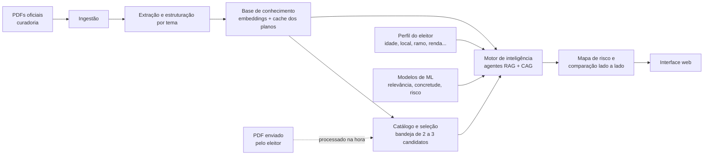

# Confere

Comparador de candidatos e políticos orientado ao perfil do eleitor.

O Confere compara **candidatos e políticos** a partir do que consta em seus planos de governo. Ele recebe os planos em PDF, entende o que cada político propõe e mostra, lado a lado, **os pontos fortes, os pontos fracos e os riscos de cada um para a realidade de quem está consultando**. O eleitor informa dados de contexto (idade, cidade, ramo de atuação, renda atual, renda esperada em 5 anos, etc.) e o sistema destaca o que, nas propostas de cada político, tende a afetar aquele perfil, sempre citando o trecho original do documento.

> **Status:** protótipo da interface em [`web/`](web/README.md), com dados fictícios e sem backend. Os demais componentes estão descritos em nível funcional em [`docs/`](docs/README.md).

---

## O problema

Saber o que cada político realmente propõe dá trabalho: os planos de governo são longos, heterogêneos e difíceis de comparar. Cada candidato organiza os temas de um jeito, usa vocabulário próprio e mistura metas concretas com intenções genéricas. O eleitor comum não tem tempo de ler centenas de páginas, e as análises disponíveis raramente consideram a situação específica de quem lê: uma proposta tributária afeta de forma diferente um MEI de 25 anos no interior e um assalariado de 50 anos numa capital.

## A proposta

1. **Entender o eleitor.** A partir de dados de contexto informados voluntariamente, o sistema identifica quais temas e quais tipos de proposta são mais relevantes para aquele perfil. É o primeiro passo do assistente de comparação e pode ser pulado.
2. **Escolher quem comparar, como num comparador de produtos.** O eleitor navega por um catálogo de candidatos com planos já processados e verificados, adiciona de 2 a 3 deles à comparação e, se quiser, envia o PDF de um plano que ainda não está no catálogo.
3. **Ler e organizar os planos.** O sistema extrai o conteúdo dos PDFs e o reorganiza numa mesma taxonomia de temas (economia, segurança, saúde, educação, etc.), para que propostas equivalentes fiquem lado a lado.
4. **Analisar com inteligência e com evidência.** Agentes de IA consultam os planos (combinando RAG e CAG) e modelos de machine learning avaliam relevância, concretude e risco de cada proposta. Toda conclusão aponta o trecho e a página do plano que a sustenta.
5. **Mostrar o mapa de risco.** O resultado é um painel comparativo por tema, com pontos fortes, pontos fracos, lacunas (o que o plano não aborda) e o nível de risco de cada candidato para aquele perfil.

## Como funciona (visão funcional)

## Exemplo do que o eleitor vê

Perfil informado: 34 anos, Campinas (SP), profissional autônomo de tecnologia, renda de R$ 8 mil/mês, expectativa de R$ 15 mil/mês em 5 anos.
Prioridades escolhidas: economia, segurança, educação.

| Tema | Candidato A | Candidato B |
|---|---|---|
| **Economia** (alta relevância) | ✅ Simplificação do regime de autônomos com meta e prazo (p. 12)   ⚠️ Não indica fonte de compensação da perda de arrecadação   **Risco: médio** | ✅ Linha de crédito para pequenos negócios de tecnologia (p. 8)   ❌ Proposta de nova faixa de IR atinge a renda esperada do perfil (p. 9)   **Risco: alto** |
| **Segurança** (média relevância) | ❌ Propostas genéricas, sem metas (p. 30)   **Risco: alto** | ✅ Metas regionais de redução de crimes patrimoniais incluindo o interior paulista (p. 22)   **Risco: baixo** |
| **Educação** (média relevância) | ✅ Programa de requalificação em tecnologia para adultos (p. 41)   **Risco: baixo** | ➖ Tema abordado só para ensino básico; sem impacto direto no perfil   **Risco: neutro** |

*(Exemplo ilustrativo com candidatos fictícios.)*

## Princípios do produto

- **Neutralidade.** O sistema não recomenda voto. Ele compara propostas com critérios iguais para todos os candidatos e deixa a decisão com o eleitor.
- **Evidência acima de opinião.** Toda afirmação aponta para o trecho original do plano. Sem citação, a afirmação não é exibida.
- **Privacidade por padrão.** Só pedimos dados de contexto não sensíveis, nunca intenção de voto ou opinião política, e não identificamos o usuário. Veja [Privacidade e LGPD](docs/09-privacidade-e-lgpd.md).
- **Transparência.** O eleitor pode ver por que um tema foi considerado relevante e como o nível de risco foi atribuído.

## Documentação

A descrição funcional de cada componente está em [docs/](docs/README.md):

| # | Componente | Resumo |
|---|---|---|
| 01 | [Ingestão de documentos](docs/01-ingestao-de-documentos.md) | Recebe e valida os PDFs dos planos |
| 02 | [Extração e estruturação](docs/02-extracao-e-estruturacao.md) | Transforma o PDF em propostas organizadas por tema |
| 03 | [Base de conhecimento](docs/03-base-de-conhecimento.md) | Embeddings e cache que permitem consultar os planos |
| 04 | [Perfil do eleitor](docs/04-perfil-do-eleitor.md) | Coleta o contexto do usuário e suas prioridades |
| 05 | [Motor de inteligência](docs/05-motor-de-inteligencia.md) | Agentes que analisam os planos usando RAG e CAG |
| 06 | [Modelos de machine learning](docs/06-modelos-de-machine-learning.md) | Relevância, concretude e pontuação de risco |
| 07 | [Mapa de risco e comparação](docs/07-mapa-de-risco-e-comparacao.md) | O resultado lado a lado entregue ao eleitor |
| 08 | [Experiência do usuário](docs/08-experiencia-do-usuario.md) | Jornada na interface web |
| 09 | [Privacidade e LGPD](docs/09-privacidade-e-lgpd.md) | Que dados usamos e como os protegemos |
| 10 | [Neutralidade e transparência](docs/10-neutralidade-e-transparencia.md) | Como evitamos viés e explicamos os resultados |
| 11 | [Catálogo e seleção de candidatos](docs/11-catalogo-e-selecao-de-candidatos.md) | Escolha de candidatos do catálogo com filtros de nome, cargo e local, ou envio de plano próprio, como num comparador de produtos |
| 12 | [Histórico de mandato](docs/12-historico-de-mandato.md) | Painel de análise de quem está em exercício (página própria, com filtros e gráficos) e, para quem já governou ou legislou, o que prometeu, o que concluiu e o que falta |
| 13 | [Curadoria e contribuições](docs/13-curadoria-e-contribuicoes.md) | Envio de sites e arquivos por qualquer pessoa, fila pública priorizada por votos e decisão da curadoria |
| 14 | [Proteção contra raspagem](docs/14-protecao-contra-raspagem.md) | Camadas contra coleta em massa e uso para treinar IA: robots.txt, cabeçalhos, termos de uso e o que o servidor real precisa ter |
| 15 | [Medição de uso](docs/15-medicao-de-uso.md) | Google Analytics só após consentimento e sem enviar candidato, perfil ou prioridades |
| 16 | [Feedback e registro de uso](docs/16-feedback-e-registro-de-uso.md) | "Faz sentido / não faz sentido" por seção e registro opcional de navegação, com consentimento separado |
| 17 | [Visualizador do plano e rotulagem](docs/17-visualizador-do-plano-e-rotulagem.md) | Mostra onde cada compromisso está escrito no PDF ou imagem e deixa qualquer pessoa ajudar a marcar |

## Estrutura do repositório

| Pasta | Papel previsto |
|---|---|
| `web/` | Interface do eleitor (formulário de perfil e painel comparativo) |
| `bff/` | Camada que atende a interface e orquestra chamadas aos serviços |
| `service/` | Ingestão, extração, agentes e modelos de ML |
| `data/` | Catálogo de candidatos e planos de referência, taxonomia de temas e conjuntos de avaliação |
| `docs/` | Documentação funcional do produto |
