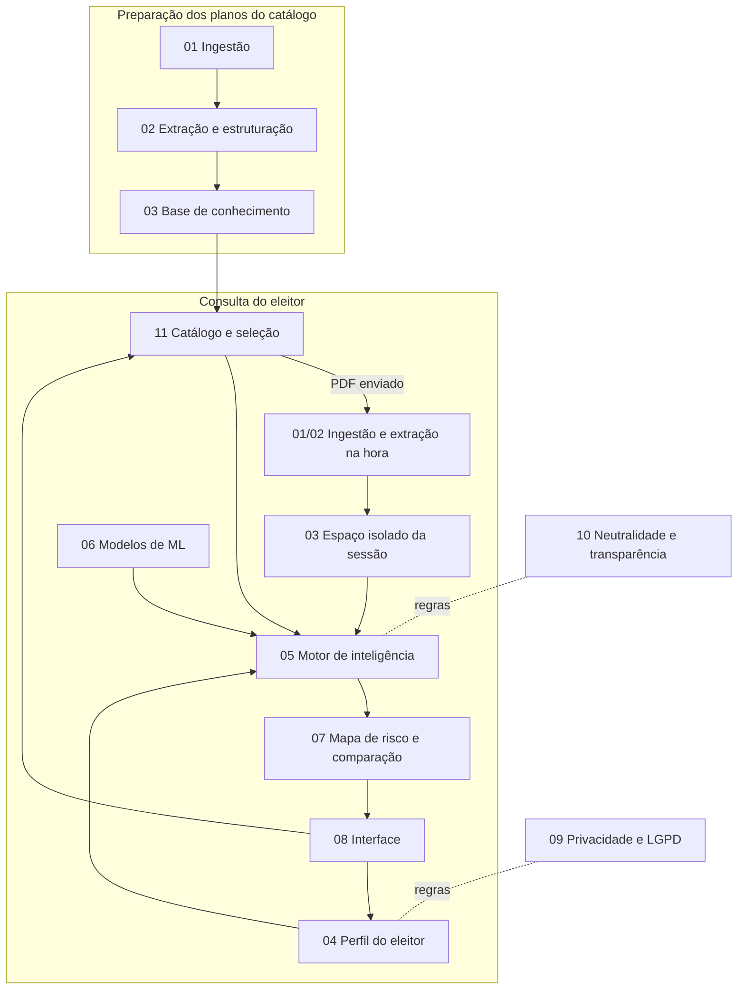

# Documentação funcional

Esta pasta descreve **o que** cada componente do Confere faz, sem entrar ainda em decisões técnicas (linguagens, bibliotecas, infraestrutura). A visão geral do produto está no [README principal](../README.md).

## Componentes

1. [Ingestão de documentos](01-ingestao-de-documentos.md)
2. [Extração e estruturação](02-extracao-e-estruturacao.md)
3. [Base de conhecimento](03-base-de-conhecimento.md)
4. [Perfil do eleitor](04-perfil-do-eleitor.md)
5. [Motor de inteligência (agentes, RAG e CAG)](05-motor-de-inteligencia.md)
6. [Modelos de machine learning](06-modelos-de-machine-learning.md)
7. [Mapa de risco e comparação](07-mapa-de-risco-e-comparacao.md)
8. [Experiência do usuário](08-experiencia-do-usuario.md)
9. [Privacidade e LGPD](09-privacidade-e-lgpd.md)
10. [Neutralidade e transparência](10-neutralidade-e-transparencia.md)
11. [Catálogo e seleção de candidatos](11-catalogo-e-selecao-de-candidatos.md)
12. [Histórico de mandato](12-historico-de-mandato.md)
13. [Curadoria e contribuições](13-curadoria-e-contribuicoes.md)
14. [Proteção contra raspagem](14-protecao-contra-raspagem.md)
15. [Medição de uso](15-medicao-de-uso.md)
16. [Feedback e registro de uso](16-feedback-e-registro-de-uso.md)
17. [Visualizador do plano e rotulagem](17-visualizador-do-plano-e-rotulagem.md)

## Fluxo entre componentes

A **preparação dos planos do catálogo** acontece uma vez por plano (ou a cada nova versão publicada). A **consulta do eleitor** acontece a cada uso: reaproveita tudo o que foi preparado para o catálogo e processa na hora apenas o PDF que o eleitor eventualmente enviar.

## Glossário

| Termo | Significado neste projeto |
|---|---|
| **Plano de governo** | Documento oficial de propostas de um candidato, normalmente registrado no TSE. |
| **Proposta** | Unidade mínima de análise: um compromisso ou medida extraída do plano, com tema e página de origem. |
| **Tema** | Categoria da taxonomia comum (economia, segurança, saúde...) usada para alinhar os planos. |
| **Perfil do eleitor** | Conjunto de dados de contexto informados pelo usuário, mais as prioridades que ele escolhe. |
| **Embedding** | Representação numérica do significado de um trecho de texto, que permite encontrar trechos parecidos mesmo com palavras diferentes. |
| **RAG** | *Retrieval-Augmented Generation*: a IA busca os trechos mais relevantes do plano no momento da pergunta e responde com base neles. |
| **CAG** | *Cache-Augmented Generation*: o conteúdo estável (planos completos, taxonomia, regras) fica pré-carregado para a IA, dando respostas mais rápidas e consistentes. |
| **Agente** | Componente de IA com uma responsabilidade específica (extrair, analisar um tema, comparar, verificar). |
| **Concretude** | Quanto uma proposta é específica: tem meta, prazo, responsável e fonte de recursos. |
| **Risco** | Chance de o plano não entregar o que promete ou de afetar negativamente o perfil do eleitor naquele tema. |
| **Lacuna** | Tema relevante para o perfil que o plano não aborda ou aborda superficialmente. |
| **Catálogo** | Conjunto de candidatos com planos já processados e verificados pela curadoria. |
| **Bandeja de comparação** | Seleção de 2 a 3 candidatos que o eleitor quer comparar, como em um comparador de produtos. |
| **Compromisso** | Promessa extraída do plano da última campanha e acompanhada ao longo do mandato (concluído, em andamento ou pendente). |
| **Rotulagem (labeling)** | Marcação, feita por qualquer pessoa, da área do documento onde um compromisso está escrito; só vira oficial depois de aprovada pela curadoria. |
| **Registro de uso** | Log anônimo e opcional dos passos do eleitor (etapas, abas, temas e candidatos abertos), que ele pode ver, baixar e apagar. |
| **Contribuição** | Site ou arquivo enviado por qualquer pessoa como informação adicional ou correção, que só entra no perfil depois de aprovado pela curadoria. |
| **Fila de curadoria** | Lista pública de contribuições aguardando análise, ordenada pelos votos de priorização da comunidade. |
| **Plano não verificado** | Plano enviado pelo eleitor em PDF, processado na hora e válido só durante a sessão. |
